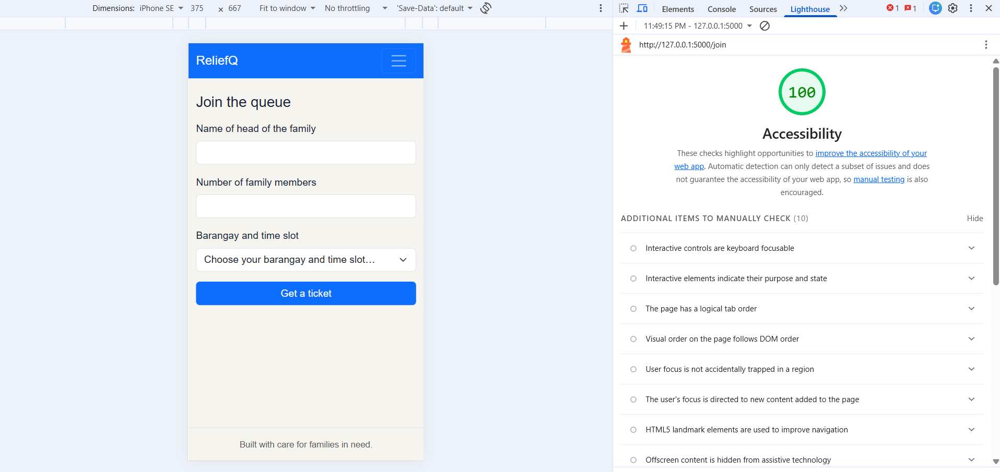
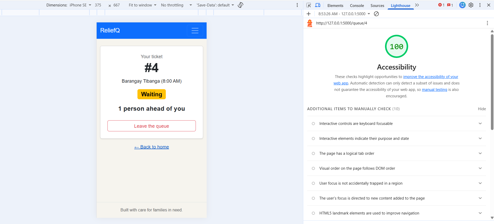
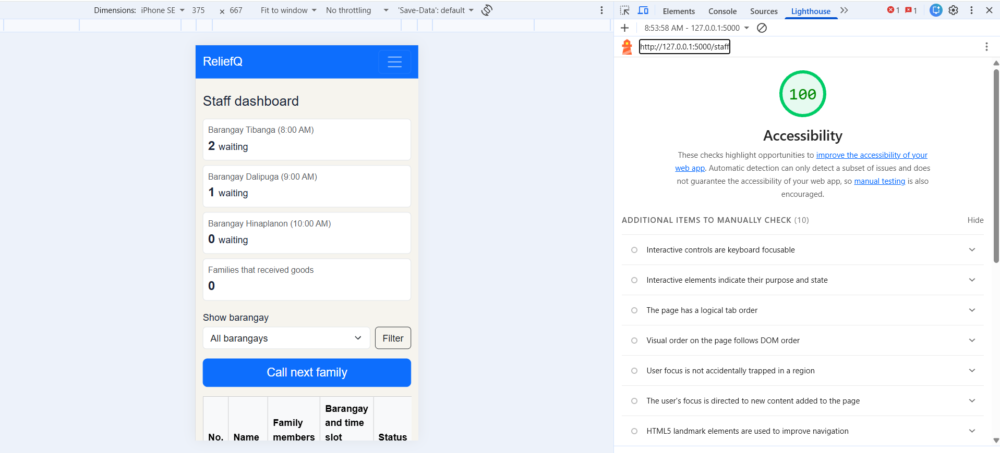

# Accessibility check

## 9a. Lighthouse

| Screen | Score before fixes | Score after fixes | Screenshot (final score) |
| --- | --- | --- | --- |
| Join | 100 | 100 |  |
| My place | 94 | 100 |  |
| Staff dashboard | 95 | 100 |  |

**Issue:** Lighthouse showed one issue on the "My place" and "Staff dashboard" screens: "Background and foreground colors do not have a sufficient contrast ratio." Low-contrast text is hard to read for many users.

- On "My place", the failing element was the "Back to home" link. The blue was too light on the cream background.
- On "Staff dashboard", the failing element was the "Filter" button. Its gray text was hard to see on the background.

**Fix for "My place":** I made the "Back to home" link a darker in css.

**Fix for "Staff dashboard":** I changed the Filter button from btn-outline-secondary to btn-outline-dark.

## 9b. Keyboard only

**Join the queue from the home page** 
- I could see where the focus was at every step, except on the menu bar links ("Join the queue" and "Staff"), where the focus was hard to see against the blue background. 
- Yes, I could reach and use every control, including the dropdown and the Get a ticket button. 
- Yes, the skip link appeared on the first tab, in the upper right part of the page.

**Staff dashboard** 
- I could filter by barangay with the keyboard, use Call next family, and use Received and No-show. 
- Yes, I could see the focus at every step, except again on the menu bar links. 
- Yes, the skip link also appeared on this screen.

**What failed and how I fixed it.** The only problem was the menu bar links: the focus and hover styles were not clear on the blue navbar. I fixed it by making the link text white, underlining it on hover, and adding a thick white outline when a link has keyboard focus.

## 9c. Manual checklist

| Check | Join | My place | Staff |
| --- | --- | --- | --- |
| Every input has a visible label | ✅ | N/A (no inputs) | ✅  |
| Error messages say what to do, in text | ✅ | N/A (no fields to fill in) | N/A (no fields to fill in) |
| Status is shown in words, not only color | N/A (no status) | ✅ | ✅ |
| Text and buttons are readable at 375 px with no sideways page scroll | ✅ | ✅ | ✅ |
| Buttons are at least about 44 × 44 px on a phone | ❌ (fix: .btn and form fields have a minimum height of 44 px in css) | ❌(fix: .btn and form fields have a minimum height of 44 px in css)  | ✅ |
| Page has one `<h1>` and headings in order | ✅ | ❌ (fix: "Your ticket" is now an `<h1>`) | ✅ |
| `<html lang="en">` is set | ✅ | ✅ | ✅ |