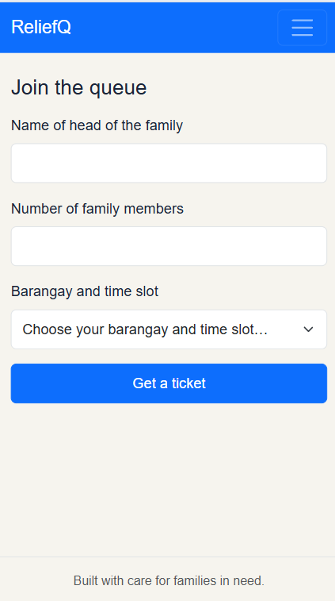
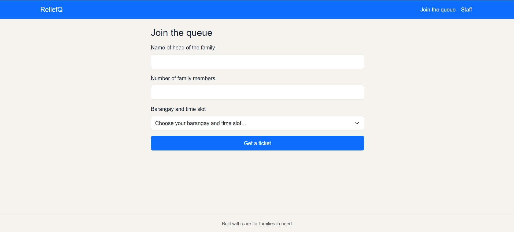
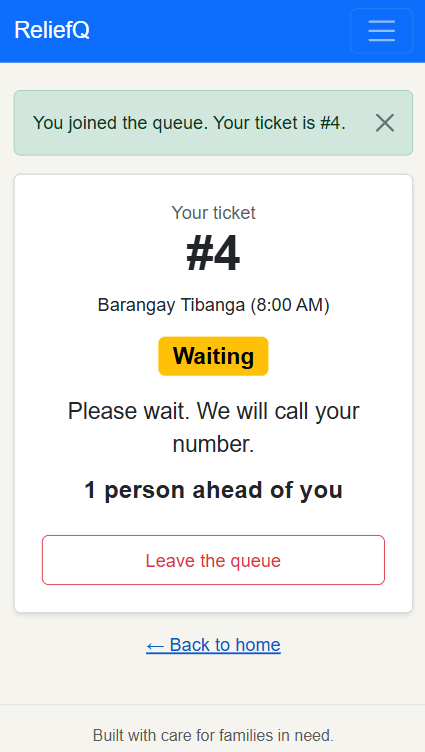
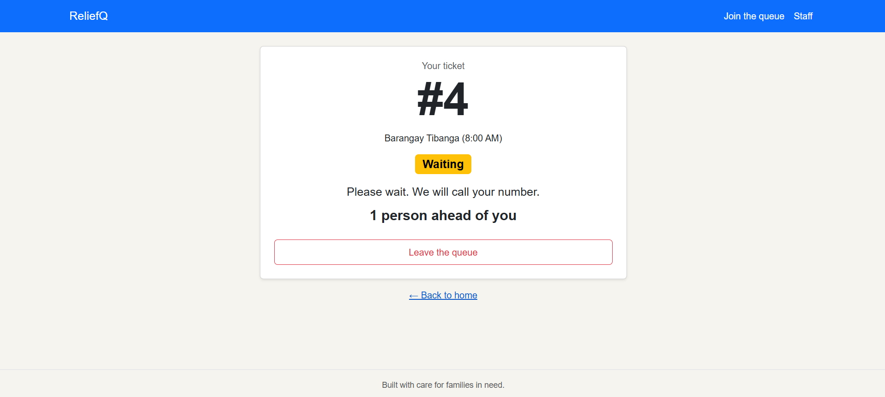
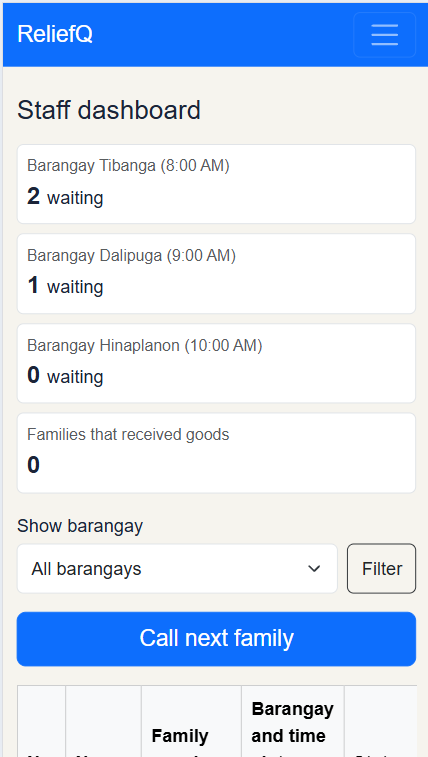
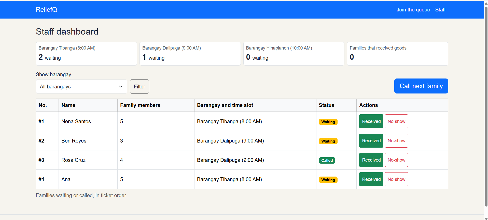
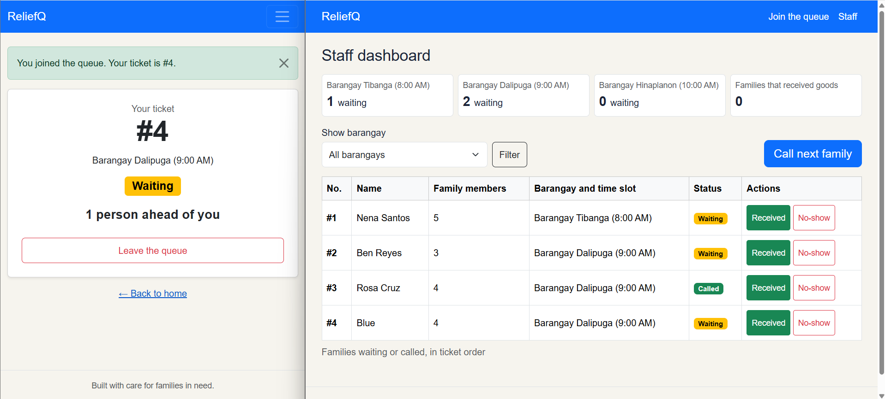
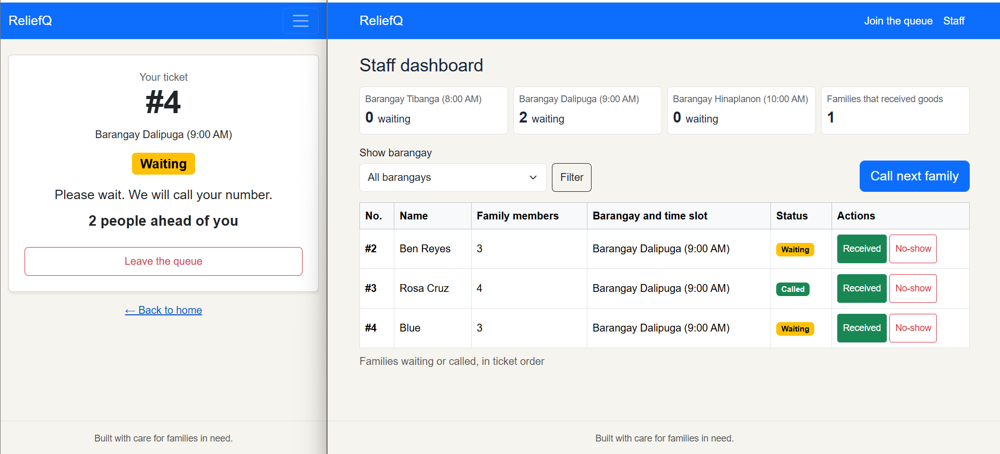

# Report

## 1. Title details

| | |
| --- | --- |
| **App name** | ReliefQ |
| **Setting** | Relief goods distribution in a barangay |
| **Full name** | Shasheenah Deeneille C. Lumasag |
| **Student ID** | 2023-0483 |
| **Section** | CS3B |
| **Date** | October 24, 2026 |
| **Pull request** | https://github.com/shasheenahdeeneillelumasag/ccc181/pulls |

## 2. Personas

Full personas: [personas.md](personas.md)

**Swaegg, the person waiting**
- Quote: "Di na need mulinya physically. Pwede lang muwait sa kilid, then kung imoa nang turn, muduol lang dayon ka [There's no need to line up physically. I can wait on the side, then come up when it's my turn]"
- Top tasks: join the queue (FR-01) and check how many families are ahead (FR-02).

**Rea, the staff member**
- Quote: "We simply let the children line up, and we accommodated them based on who arrived first. We did not have a formal queuing system in place." (interview)
- Top tasks: see the waiting list, call the next family, and mark a family as received or no-show (FR-03).

## 3. Screens

Join on a phone: used by Swaegg to get a ticket (FR-01).

Join on a laptop: used by Swaegg (or staff/volunteer helping a family/person) to get a ticket (FR-01).

My place on a phone: used by Swaegg to see his number, status, and position (FR-02).

My place on a laptop: used by Swaegg (or staff/volunteer helping a family/person) to see his number, status, and position (FR-02).

Staff dashboard on a phone: used by Rea while she is at the place (FR-03).

Staff dashboard on a laptop: used by Rea at a table with a laptop. (FR-03).

## 4. Design decisions

1. **The ticket number is very large on My place.** Swaegg said in the interview that small font is a problem for him, and his family shares one phone that he glances at while waiting on the side.
2. **The staff dashboard shows each family's name and time slot, with one-tap Received and No-show buttons.** Rea said on the interview that she wants a straightforward screen with clear, essential information.
3. **The join form has only three fields, with no email and no login.** Swaegg's family has no mobile data and shares one phone based from the interview. The fields are only the head of the family's name, the number of family members, and the barangay with its time slot.

## 5. Self-review

- **Join:** The form was simple, but it did not show what happens when a field is blank or the number of members is not a number. I kept the layout. I added clear error messages in text under each field.
- **My place:** The wireframe only showed the Waiting state, and the note "Updated just now" could be false when there is no signal. I kept the layout. I built all four states (Waiting, Called, Received, No-show), each with a word and a color, and the page refreshes by itself every 10 seconds. I did not build the "last updated time" field yet.
- **Staff dashboard:** The wireframe did not show how a family marked as "Received" would look. It also lacked a summary of how many families or individuals were waiting in each barangay. I maintained the layout while adding a waiting summary for each barangay. Additionally, once a family is marked as received, they are removed from the list.

## 6. Accessibility
Lighthouse accessibility scores 

| Screen | Before | After |
| --- | --- | --- |
| Join | 100 | 100 |
| My place | 94 | 100 |
| Staff dashboard | 95 | 100 |

The most important issue I fixed was low color contrast: the "Back to home" link on My place and the Filter button on the staff dashboard. I also made buttons at least 44 px tall, added a single `<h1>` to My place, and made the menu bar links easier to see with the keyboard.

## 7. Usability test

- **Task 1, get in line for his barangay and get a ticket (about 57 seconds):** He wondered because his barangay was not in the dropdown. There was no option for it.
- **Task 2, how many families are ahead and what is his ticket number (about 1 minute 19 seconds):** He did not hesitate. He noticed right away that the status changed on My place. He saw his ticket number, #4, and "1 person ahead of you".
- **Task 3, as staff, call the next family and mark them as received (about 1 minute 57 seconds):** He did not hesitate. He explained what he could do on the staff dashboard and said he could use the filter.

**The one improvement:** The position in line was not clear. My place only counted families that were still waiting ahead of the person, so the number dropped as soon as staff clicked 'Call next family' , even though that family had not received their goods yet. Also, a Called ticket did not show how many people were ahead. Now the count includes families that are waiting or called, so it only goes down when staff mark a family as received or no-show, and the position shows on both Waiting and Called tickets.

| Before | After |
| --- | --- |
|  |  |

## 8. Reflection

The hardest part this week was the setup and the first routes. On my laptop, Python was not found at first, and Windows blocked `flask.exe`, so I had to run the app with `python -m flask`. I also had to learn how a route, a template, and a POST form work together, and how to keep the typed values after an error.

In Week 4, my tickets will move from a Python list into a database. Right now the tickets disappear every time the app restarts, and the ticket number is made from the last ticket in the list. In a database, the ticket number can be made by the database, and the barangays and time slots can be stored in their own table. I will also change the staff dashboard so received and no-show tickets stay in the data, so staff can see who already received and stop duplicate claims. The "people ahead" count can then be a database query.

## 9. Declaration

I used Claude while working on this week's activity. I used it to help me plan the steps, check my grammar, explain parts I didn't understand, and fix bugs or errors.