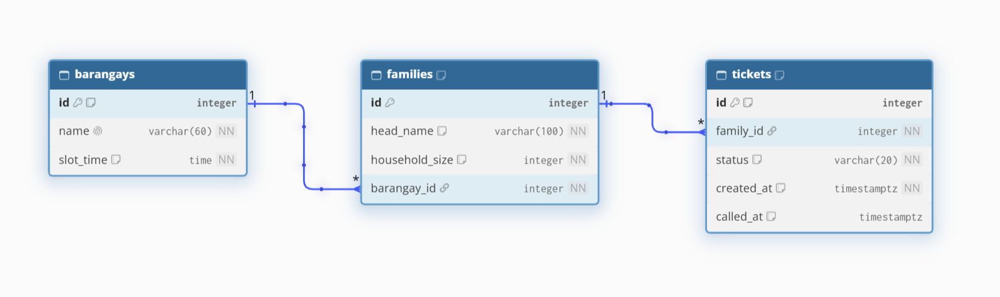
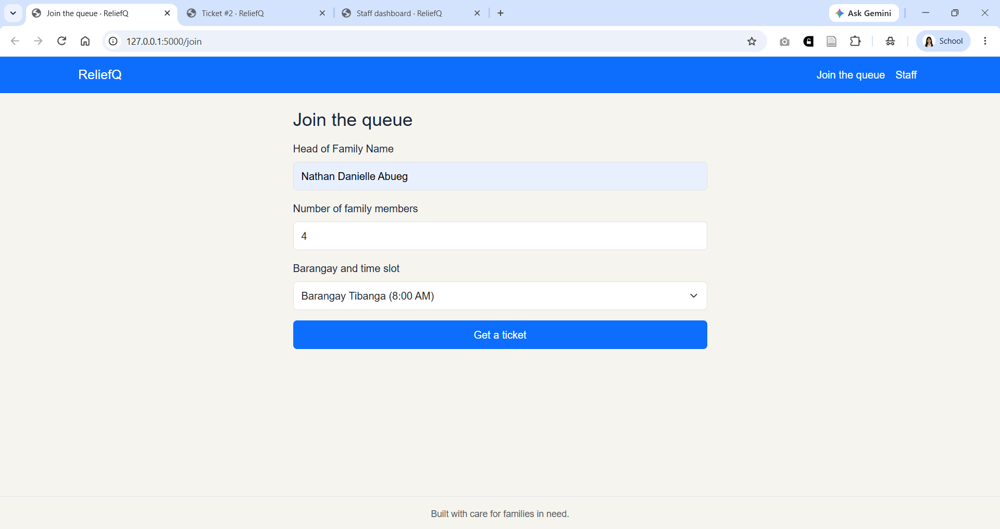
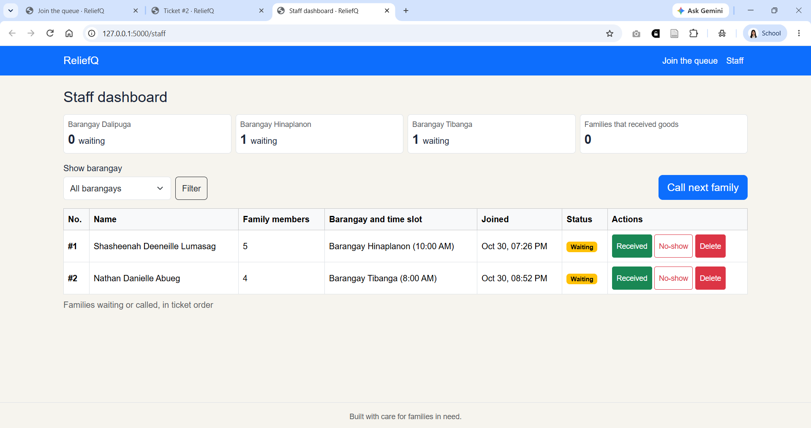
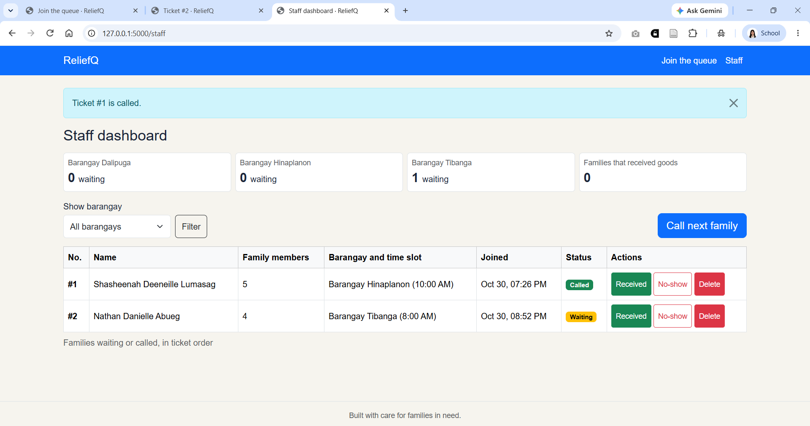
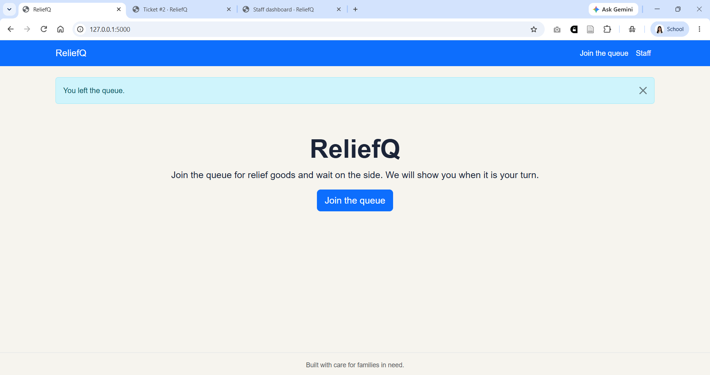
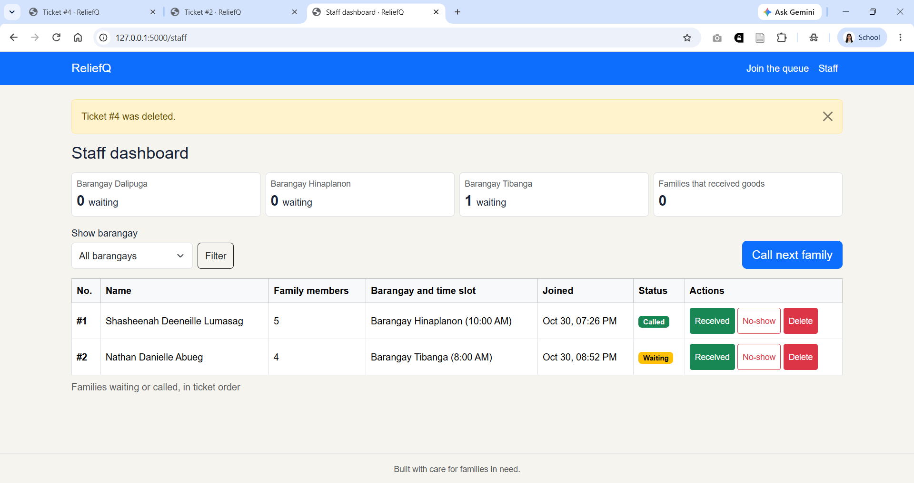
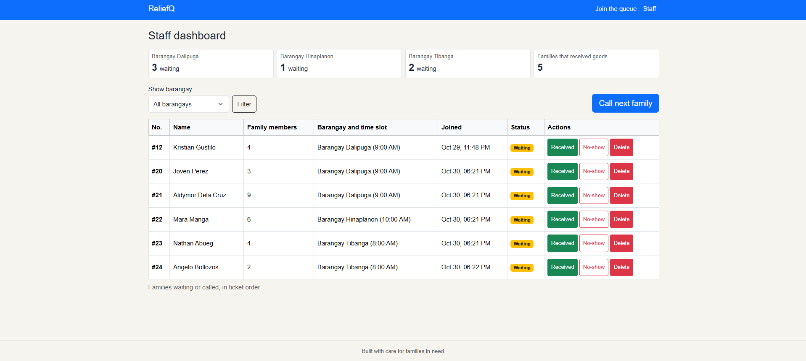
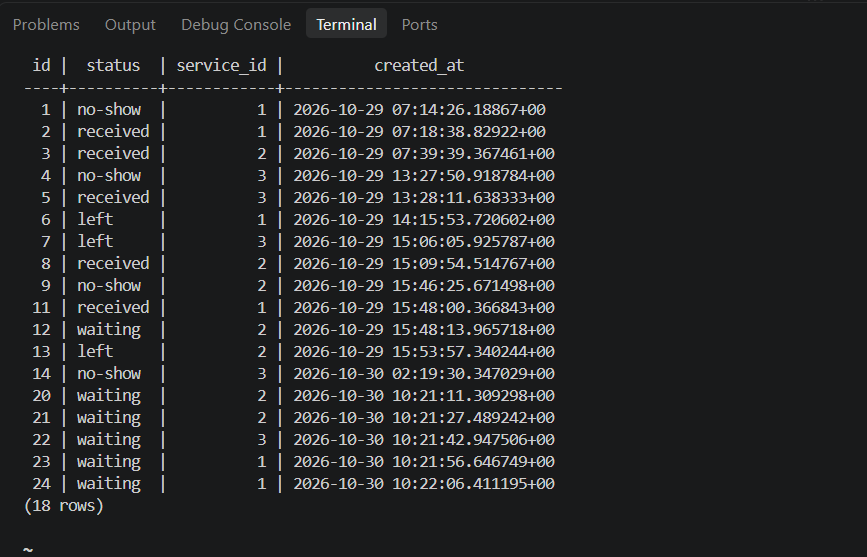
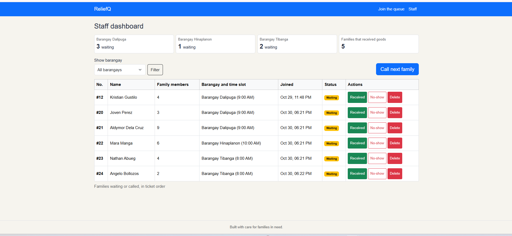
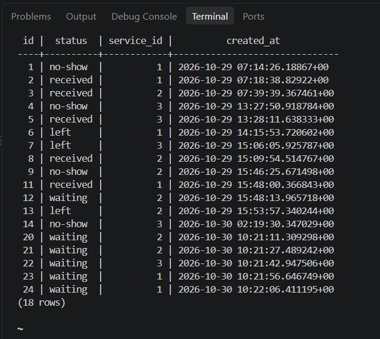

# Report

## 1. Title details

| | |
| --- | --- |
| **App name** | ReliefQ |
| **Setting** | Relief goods distribution in a barangay |
| **Full name** | Shasheenah Deeneille C. Lumasag |
| **Student ID** | 2023-0483 |
| **Section** | CS3B |
| **Date** | October 30, 2026 |
| **Pull request** | https://github.com/shasheenahdeeneillelumasag/ccc181/pull/3 |

## 2. Requirements
- **Functional requirements:** 13 (FR-01 to FR-13)
- **Non-functional requirements:** 7 (NFR-01 to NFR-07)
- **MVP:** 
    1. Must Functional requirements: FR-01, FR-02, FR-04, FR-05, FR-06, FR-07, FR-08
    2. Must non-functional requirements: NFR-01, NFR-02, NFR-03, NFR-05, NFR-06, NFR-07.
- **Feedback from my setting:** A person who has received relief goods before told me FR-11 (paper tickets) felt out of place because it is about people without phones and not about the app. I changed FR-11 from "Later" to "Dropped" and moved it to the out-of-scope list. I kept its ID so it is never reused.
- **Full requirements:** [docs/requirements.md](../requirements.md)

## 3. ERD



1. One barangay has many families. Each family belongs to exactly one barangay. (1:N)
2. One family has many tickets over time. Each ticket belongs to exactly one family. (1:N)

- **Full schema design:** [docs/week4/schema.md](schema.md)

## 4. Schema

```
reliefq=# \d
               List of relations
 Schema |       Name       |   Type   |  Owner  
--------+------------------+----------+---------
 public | alembic_version  | table    | reliefq
 public | barangays        | table    | reliefq
 public | barangays_id_seq | sequence | reliefq
 public | families         | table    | reliefq
 public | families_id_seq  | sequence | reliefq
 public | tickets          | table    | reliefq
 public | tickets_id_seq   | sequence | reliefq
(7 rows)
```

```
reliefq=# \d barangays
                                     Table "public.barangays"
  Column   |          Type          | Collation | Nullable |                Default                
-----------+------------------------+-----------+----------+---------------------------------------
 id        | integer                |           | not null | nextval('barangays_id_seq'::regclass)
 name      | character varying(60)  |           | not null | 
 slot_time | time without time zone |           | not null | 
 active    | boolean                |           | not null | true
Indexes:
    "barangays_pkey" PRIMARY KEY, btree (id)
    "barangays_name_key" UNIQUE CONSTRAINT, btree (name)
Referenced by:
    TABLE "families" CONSTRAINT "families_barangay_id_fkey" FOREIGN KEY (barangay_id) REFERENCES barangays(id) ON DELETE RESTRICT

reliefq=# 
```

```
reliefq=# \d families

                                        Table "public.families"
     Column     |          Type          | Collation | Nullable |               Default                
----------------+------------------------+-----------+----------+--------------------------------------
 id             | integer                |           | not null | nextval('families_id_seq'::regclass)
 head_name      | character varying(100) |           | not null | 
 household_size | integer                |           | not null | 
 barangay_id    | integer                |           | not null | 
Indexes:
    "families_pkey" PRIMARY KEY, btree (id)
    "uq_families_barangay_head_name" UNIQUE CONSTRAINT, btree (barangay_id, head_name)
Check constraints:
    "ck_families_head_name" CHECK (length(TRIM(BOTH FROM head_name)) > 0)
    "ck_families_household_size" CHECK (household_size >= 1)
Foreign-key constraints:
    "families_barangay_id_fkey" FOREIGN KEY (barangay_id) REFERENCES barangays(id) ON DELETE RESTRICT
Referenced by:
    TABLE "tickets" CONSTRAINT "tickets_family_id_fkey" FOREIGN KEY (family_id) REFERENCES families(id) ON DELETE RESTRICT
```

```
reliefq=# \d tickets

                                       Table "public.tickets"
   Column   |           Type           | Collation | Nullable |               Default               
------------+--------------------------+-----------+----------+-------------------------------------
 id         | integer                  |           | not null | nextval('tickets_id_seq'::regclass)
 family_id  | integer                  |           | not null | 
 status     | character varying(20)    |           | not null | 'waiting'::character varying
 created_at | timestamp with time zone |           | not null | now()
 called_at  | timestamp with time zone |           |          | 
Indexes:
    "tickets_pkey" PRIMARY KEY, btree (id)
    "ix_tickets_family_id" btree (family_id)
    "uq_tickets_one_open_per_family" UNIQUE, btree (family_id) WHERE status::text = ANY (ARRAY['waiting'::character varying, 'called'::character varying]::text[])
    "uq_tickets_one_received_per_family" UNIQUE, btree (family_id) WHERE status::text = 'received'::text
Check constraints:
    "ck_tickets_called_at_after_created" CHECK (called_at IS NULL OR called_at >= created_at)
    "ck_tickets_status" CHECK (status::text = ANY (ARRAY['waiting'::character varying, 'called'::character varying, 'received'::character varying, 'no-show'::character varying, 'left'::character varying]::text[]))
Foreign-key constraints:
    "tickets_family_id_fkey" FOREIGN KEY (family_id) REFERENCES families(id) ON DELETE RESTRICT
```

## 5. Design decisions:
1.  I do not keep a "position" column. The place is worked out from `created_at`, `status` and `household_size`. A family like Swaegg sees the right number every time the page refreshes, and staff like Rea never have to update other rows when someone joins or leaves.
2. A family that left or was a no-show can join again, and it reuses its saved `families` row and gets a new ticket. The ticket history is kept, so staff can still see who already received goods, and the family's name and size are stored only once.
3. I used two partial unique indexes on `tickets.family_id`. If Flask has a bug or two people press Join at the same moment, PostgreSQL still refuses a duplicate. This protects the staff's rule that no family gets goods twice.

## 6. Self-review: 
The main problems I found in my schema are: **(1)** A family could be saved twice when it rejoins. So the Flask finds the saved family by `(barangay_id, head_name)` and only adds a new ticket. Also, **(2)** nothing stopped duplicate rows in `families`. I added `UNIQUE (barangay_id, head_name)`. Then **(3)** if a family that already received goods could join again, and the database would only catch it when staff marked the second ticket as received. I kept the partial unique rule.

## 7. Migration:
1. **63ff11a52130_initial_tables.py** -> This file builds the main tables in the database to store and track barangays, families, and queue tickets.

2. **445436554ee4_add_barangays_active.py** -> This file adds an "active" true-or-false column to the barangays table so you can turn a barangay on or off without deleting it.

## 8. CRUD:

### Create:
- **Screenshot:** 
- **Route:** POST /join -> join()
- **Requirement ID:** FR-01

### Read:
- **Screenshot:** 
- **Route:** GET /staff -> staff_dashboard()
- **Requirement ID:** FR-10

### Update:
- **Screenshot:** 
- **Route:** POST /staff/call-next -> call_next()
- **Requirement ID:** FR-04

### Soft delete:
- **Screenshot:** 
- **Route:** POST /queue/<ticket_id>/leave -> leave()
- **Requirement ID:** FR-06

### Hard delete:
- **Screenshot:** 
- **Route:** POST /staff/tickets/<ticket_id>/delete -> service_ticket()
- **Requirement ID:** FR-08

## 9. Validation
I tested 16 rules in `validation.md`. 6 in Flask and 10 in the database. Flask rejects bad request with HTTP/1.1 400. The database then acts as the last line of defense with foreign keys, CHECK, UNIQUE, NOT NULL and RESTRICT. The most useful PostgreSQL error is the `ERROR: duplicate key value violates unique constraint "uq_tickets_one_open_per_family"` because it stops families from cutting the line or getting multiple tickets at the same time.

## 10. Persistence:

### Restart test screenshots:

**Before restart screenshots:**



**After restart screenshots:**



Before restarting the server and database, the list was still exactly the same. After rebuilding the database from scratch, all tables and starting barangays were created again with no errors, proving that NFR-01 passed and no ticket data gets lost.

## 11. Reflection:
The hardest part this week was setting up database constraints and handling PostgreSQL errors properly in Flask. The hardest requirement to write in a testable way was FR-13 (A family cannot join the queue again while they still have a waiting or called ticket in the same barangay) because it required testing edge cases in both Flask and database partial indexes. For future reports, my staff persona (Rea) would want a query showing how many people left the queue before getting served, broken down by barangay and day, so she can see which time slots have the longest wait times.

## 12. Declaration: 
I used Claude while working on this week's activity. I used it to help me plan the steps, check my grammar, explain parts I didn't understand, and fix bugs or errors.